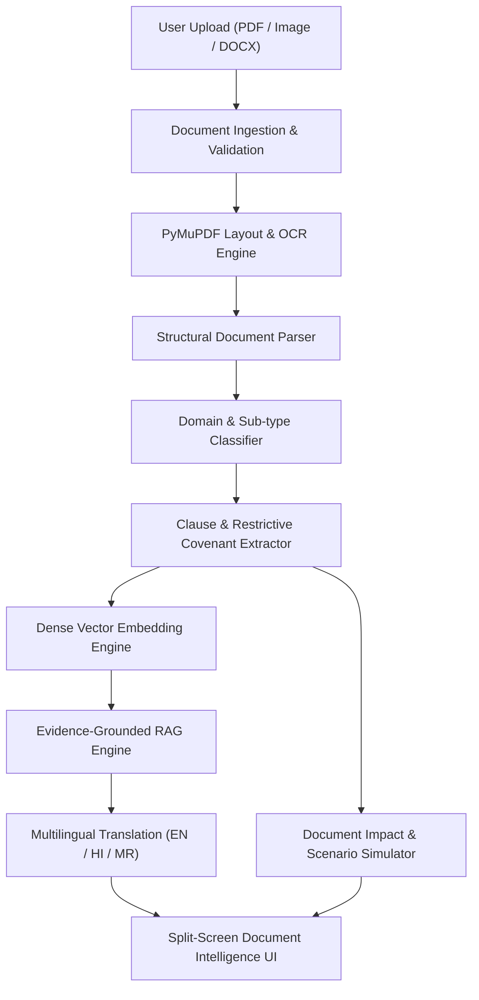

# PaperLens AI Architecture & System Design

## 1. System Overview
PaperLens AI is an open-source, multimodal AI document intelligence and legal literacy platform. It parses complex documents (employment letters, service bonds, NDAs, payslips, Aadhaar/PAN certificates) into plain-language summaries, extracts binding clauses, simulates hypothetical decision impacts, and provides verifiable RAG question answering.

## 2. Core AI Modules (`ai_engine/`)
- **`ocr/` (`ocr_engine.py`)**: Page-by-page vector text and layout block extraction using PyMuPDF. Retains block coordinates, bounding boxes, and word traces for synchronized click-to-highlight document viewing.
- **`document_parser/` (`parser.py`)**: Identifies article headings, bullet lists, dates, financial CTC figures, and parties.
- **`classification/` (`classifier.py`)**: Hybrid scoring classifier that maps documents into 6 major domains (`employment`, `government`, `education`, `financial`, `legal`, `insurance`) and granular sub-types with confidence scores.
- **`clause_extraction/` (`extractor.py`)**: Detects notice periods, probation, service bonds, non-compete clauses, confidentiality covenants, clawback terms, and IP assignment. Generates structured plain-language explanations, obligations, restrictions, deadlines, and questions to ask HR.
- **`embeddings/` (`embedding_engine.py`)**: Dense 384-dimensional vector representations with offline projection fallbacks.
- **`rag/` (`rag_pipeline.py`)**: Chunking, vector indexing, cosine similarity retrieval, evidence citations, and strict anti-hallucination verification.
- **`impact_analyzer/` (`impact_engine.py`)**: Simulates user decisions (e.g. "What happens if I leave before 6 months?"), computes financial implications, relieving letter implications, and statutory Indian Contract Act context.
- **`multilingual/` (`translator.py`)**: Localized insights and responses in English, Hindi (हिंदी), and Marathi (मराठी).
- **`evaluation/` (`evaluator.py`)**: Automated test suite measuring classification accuracy, precision, and recall on test benchmarks.

## 3. Database Schema
- **`UploadedFile`**: File metadata, storage path, byte size, OCR raw text, layout blocks.
- **`DocumentAnalysis`**: Classification domain, sub-type, confidence, executive summary, key extracted parameters.
- **`ExtractedClause`**: Extracted clause records, obligations, restrictions, deadlines, consequences, questions to ask, source page.
- **`DocumentReference`**: Citations and text snippets for grounding.
- **`ChatSession` & `ChatMessage`**: Conversational history and retrieved citations.
- **`KnowledgeBaseEntry`**: 20+ verified document guides across government and employment.
- **`UserChecklist`**: Dynamic checklists with interactive toggle tracking.
